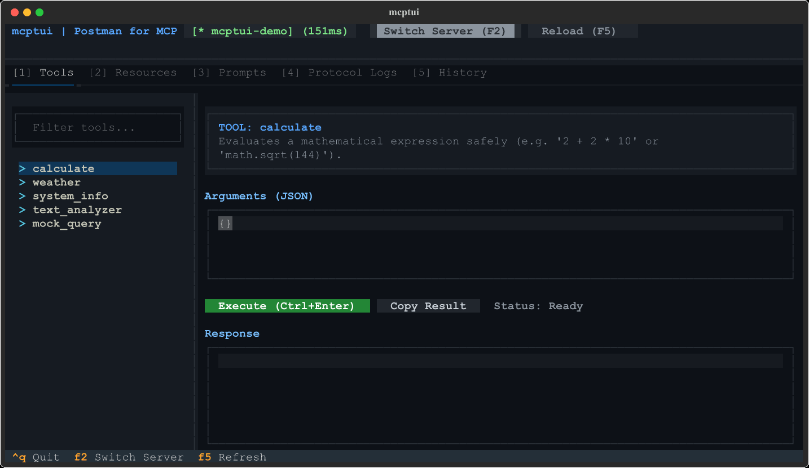

# mcptui

<div align="center">

<h3><b>The Postman for Model Context Protocol (MCP)</b></h3>

*A modern, interactive Terminal UI and playground for testing, inspecting, and debugging MCP servers.*

<p>
  <a href="https://pypi.org/project/mcptui/"></a>
  <a href="https://python.org"></a>
  <a href="https://modelcontextprotocol.io"></a>
  <a href="https://textual.textualize.io"></a>
  <a href="https://github.com/kimarsen/mcptui/pkgs/container/mcptui"></a>
  <a href="LICENSE"></a>
</p>

<p align="center">
  
</p>

</div>

---

## 🚀 How to Run mcptui (Quickstart)

Choose whichever method you prefer:

### ⚡ Method 1: Zero-Install (`uvx`)
`uvx` comes bundled automatically with [`uv`](https://docs.astral.sh/uv/) (just like `npx` comes with `npm`). Launch `mcptui` instantly without cloning or setting up virtual environments:
```bash
# Launch interactive demo playground:
uvx mcptui demo

# Connect directly to your own MCP server script:
uvx mcptui run "python my_server.py"
```
*(Don't have `uv` yet? Install it in 2 seconds: `powershell -c "irm https://astral.sh/uv/install.ps1 | iex"` on Windows, or `curl -LsSf https://astral.sh/uv/install.sh | sh` on macOS/Linux).*

### 📦 Method 2: Install via pip / uv tool (Standard CLI)
```bash
# Install globally with uv:
uv tool install mcptui

# Or with standard pip / pipx:
pip install mcptui

# Now 'mcptui' is available everywhere in your terminal:
mcptui demo
mcptui run "python my_server.py"
mcptui servers
```

### 🛠 Method 3: Clone & Run in PowerShell / Bash
```powershell
# 1. Clone the repository
git clone https://github.com/kimarsen/mcptui.git
cd mcptui

# 2. Launch interactive demo in 1 command
uv run mcptui demo
```

### 🐳 Method 4: Run with Docker (GitHub Packages)
Run `mcptui` instantly without installing Python, uv, or dependencies on your system:
```bash
# Launch interactive demo in Docker:
docker run -it --rm ghcr.io/kimarsen/mcptui:latest demo

# Or connect to a remote MCP server via SSE:
docker run -it --rm ghcr.io/kimarsen/mcptui:latest connect http://host.docker.internal:8000/sse
```

### ☁️ Method 5: Run in Cloud with GitHub Codespaces
Open a preconfigured development environment directly in your browser with 1 click:  
[](https://codespaces.new/kimarsen/mcptui)

### 📥 Method 6: GitHub Releases (.whl packages)
Pre-built wheels and source distributions are automatically packaged on every release. You can download them directly from the [Releases](https://github.com/kimarsen/mcptui/releases) page and install via `pip install mcptui-*.whl`.

---

## 🎯 Why mcptui?

Building and debugging **MCP (Model Context Protocol)** servers is rapidly becoming a core workflow for AI developers. But today, testing servers is painful:
- You have to edit `claude_desktop_config.json` and restart Claude Desktop repeatedly.
- You waste money and time on LLM token costs just to check if a simple function runs without syntax errors.
- Official web inspectors require Node.js, launch heavy browser tabs (`localhost:5173`), and don't fit into terminal workflows.

**`mcptui` fixes this completely.** It gives you a dedicated, keyboard-driven **Terminal UI (TUI)** playground to test tools, inspect schemas, browse resources, preview prompts, and watch live JSON-RPC 2.0 traffic in real time with zero token costs.

```
 ┌────────────────────────────────────────────────────────────────────────┐
 │ mcptui | Postman for MCP                [* mcptui-demo] (18ms)         │
 ├────────────────────────────────────────────────────────────────────────┤
 │ [1] Tools  [2] Resources  [3] Prompts  [4] Protocol Logs  [5] History  │
 ├─────────────────────────┬──────────────────────────────────────────────┤
 │ Filter tools...         │ TOOL: calculate                              │
 │ ─────────────────────── │ Safe arithmetic calculation                  │
 │ > calculate             │                                              │
 │ > weather               │ Arguments (JSON)                             │
 │ > system_info           │ ┌──────────────────────────────────────────┐ │
 │ > text_analyzer         │ │ { "expression": "100 * 2 + 42" }         │ │
 │ > mock_query            │ └──────────────────────────────────────────┘ │
 │                         │ [Execute (Ctrl+Enter)] [Copy Result] OK 18ms │
 │                         │                                              │
 │                         │ Response                                     │
 │                         │ ┌──────────────────────────────────────────┐ │
 │                         │ │ { "result": 242, "status": "success" }   │ │
 │                         │ └──────────────────────────────────────────┘ │
 └─────────────────────────┴──────────────────────────────────────────────┘
```

---

## 🛠 Building Your First MCP Server in 2 Minutes

Want to create your own MCP server and test it with `mcptui`? Here is the complete minimal guide:

### Step 1: Install the MCP Python SDK
```bash
pip install mcp
# or with uv:
uv add mcp
```

### Step 2: Write your server (`my_server.py`)
```python
import asyncio
from mcp.server.mcpserver import MCPServer

# 1. Initialize server
server = MCPServer("my-first-server")

# 2. Expose a tool that AI agents can execute
@server.tool(name="calculate_discount", description="Calculate price after applying percentage discount")
def calculate_discount(price: float, discount_percent: float) -> str:
    discounted = price * (1.0 - (discount_percent / 100.0))
    return f"Original: ${price}, Discount: {discount_percent}%, Final Price: ${round(discounted, 2)}"

# 3. Expose a static data resource
@server.resource(uri="store://catalog", name="Store Catalog", mime_type="application/json")
def get_catalog() -> str:
    return '{"items": ["Laptop", "Mouse", "Keyboard"], "status": "in_stock"}'

# 4. Run over standard input/output (stdio)
if __name__ == "__main__":
    asyncio.run(server.run_stdio_async())
```

### Step 3: Test and Debug Live in mcptui
```bash
uv run mcptui run "python my_server.py"
```
*Your new tool `calculate_discount` and resource `store://catalog` will instantly appear in the TUI! Fill in parameters, press `Ctrl+Enter`, and verify the output in 20ms.*

### Step 4: Connect to Claude Desktop or Cursor
Save it into your local `mcp.json` or `%APPDATA%\Claude\claude_desktop_config.json`:
```json
{
  "mcpServers": {
    "my-store-server": {
      "command": "python",
      "args": ["path/to/my_server.py"]
    }
  }
}
```
*(Or simply run `mcptui add my-store-server "python path/to/my_server.py"` and mcptui will register it for you!)*

---

## ✨ Features

- 🛠 **Interactive Tool Workspace**:
  - Auto-generates clean JSON parameter templates from tool `inputSchema`.
  - In-terminal JSON editor with error validation.
  - One-click execution (`Ctrl+Enter`) with live duration & latency measurement (`OK 18ms`).
  - Pretty-printed, syntax-highlighted output with clipboard copying.

- ⚡ **Code Snippet Generator & 1-Click Client Integration**:
  - Instant code generation for **Python SDK (`mcp`)**, **TypeScript SDK (`@modelcontextprotocol/sdk`)**, **CLI command**, and **raw JSON-RPC 2.0**.
  - **1-Click Install to Claude Desktop**: writes server configuration directly to `claude_desktop_config.json` without manual JSON editing!
  - **1-Click Install to Cursor**: writes into `.cursor/mcp.json` automatically.
  - Interactive `Export Code` modal directly inside the Tools tab.

- 🧪 **CI/CD Test Runner & Protocol Compliance Checker (`mcptui test`)**:
  - Validates protocol handshake, tool `inputSchema` specifications, resource URIs, and prompts.
  - Benchmarks RPC roundtrip latency with min/avg/max diagnostics.
  - Exits with `0` on success, `1` on failure — perfect for **GitHub Actions** and CI pipelines!
  - Supports `--json` flag for machine-readable test summaries.
  - Interactive Health Check modal in the TUI (`F6` or button `Test`).

- 📚 **Resource Explorer**:
  - Browse available server resources and dynamic URI templates.
  - Read resources with automatic syntax detection (Markdown, JSON, Plain Text).

- 💬 **Prompt Inspector**:
  - Test prompt templates with dynamic argument substitution.
  - Preview generated message sequences (System, User, Assistant) before sending them to LLMs.

- 🕵️ **Live JSON-RPC 2.0 Traffic Inspector**:
  - Intercepts and logs all raw protocol packets (`>>> SENT` and `<<< RECV`).
  - Search and filter messages by method (`tools/call`, `initialize`, etc.).
  - Protocol latency, request/response matching, and packet export.

- 🕒 **Execution History & Replay**:
  - Stores recent invocations with timestamps, status, input parameters, and duration.
  - **1-Click Replay in Editor**: press `Enter` on any history row or click `Re-run in Editor` to immediately load the recorded parameters back into the editor and switch tabs.
  - **Live History Search & Filter**: search past invocations by target name, input parameters, output content, or status (`status:ok`, `status:error`).

- 🌿 **Zero-Dependency `.env` & Environment Variable Loader**:
  - Automatically loads `.env` files from current working directory or parent directories.
  - Support for `--env-file` / `-E` and repeatable `--env` / `-e KEY=VALUE` CLI options across `mcptui`, `mcptui run`, and `mcptui test`.
  - Pass secret API tokens (`OPENAI_API_KEY`, `GITHUB_TOKEN`, etc.) directly to your MCP servers without cluttering your global OS environment.

- 🔍 **Auto-Discovery & Local Server Management**:
  - Automatically scans and imports configurations from:
    - **Claude Desktop** (`claude_desktop_config.json` on macOS, Windows, Linux)
    - **Cursor** (`.cursor/mcp.json` & global settings)
    - Local project `mcp.json` / `.mcp.json`
  - Register any server permanently with `mcptui add <name> <command>`.
  - Switch between servers on the fly with `F2`.

---

## 🤖 Headless CLI & Automation

`mcptui` also works as a scriptable headless CLI and test runner for automated testing and CI/CD pipelines:

```bash
# 1-Click Install server into Claude Desktop or Cursor:
mcptui install claude "python my_server.py"
mcptui install cursor notes

# Export code snippets & configs from terminal:
mcptui export demo --format python
mcptui export demo --format typescript --tool calculate --arguments '{"expression": "2+2"}'
mcptui export "python my_server.py" --format claude

# Automated compliance testing & latency benchmark (exits 0 on success, 1 on fail)
mcptui test "python my_server.py"
mcptui test http://localhost:8000/sse
mcptui test demo --json

# Register a server into local mcp.json permanently
mcptui add notes "python examples/sample_server.py"

# List all registered and discovered servers
mcptui servers

# Headless capabilities inspection
mcptui list notes
# Or on the fly without saving:
mcptui list --cmd "python examples/sample_server.py"

# Execute a tool headlessly and get clean JSON output
mcptui call convert_temperature '{"value": 100, "from_scale": "C", "to_scale": "F"}' --server notes

# Remove a server from local config
mcptui remove notes
```

---

## ⌨️ Keybindings

| Key / Mouse | Action |
|-------------|--------|
| `1` – `5` | Switch active tab (Tools, Resources, Prompts, Logs, History) |
| `Ctrl + Enter` | Execute active tool / Read resource / Get prompt |
| `Double-Click` | Double-click resource title or list item to immediately READ resource |
| `Enter` / Click | On History row: immediately replay invocation back into editor |
| `F2` | Open Server Switcher modal |
| `F5` / `Ctrl + R` | Reload server capabilities |
| `F6` | Run MCP Server Health Check & Compliance Test runner |
| `Tab` / `Shift + Tab` | Navigate between sidebar, editor, and response view |
| `Ctrl + Q` / `q` | Quit mcptui |

---

## 📄 License

This project is licensed under the [MIT License](LICENSE).  
Copyright (c) 2026 kimarsen and mcptui contributors.

Permission is hereby granted, free of charge, to any person obtaining a copy of this software and associated documentation files to use, copy, modify, merge, publish, distribute, sublicense, and/or sell copies without restriction, subject to the conditions in the [LICENSE](LICENSE) file. 
Contributions, feedback, and stars are warmly welcome! ⭐
